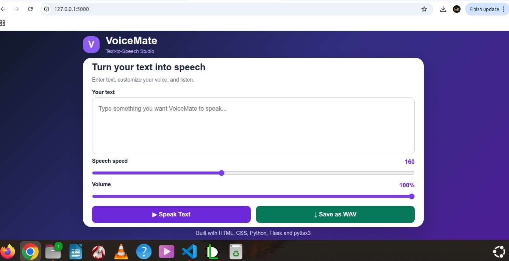

# VoiceMate – Text-to-Speech Studio

VoiceMate is a web application that converts written text into speech.

## Features
- Convert text into speech
- Adjust speech speed
- Control volume
- Listen to generated speech
- Save speech as a WAV file

## Technologies Used
- Python
- Flask
- HTML
- CSS
- pyttsx3

## Installation

1. Clone this repository.
2. Create and activate a Python virtual environment.
3. Install dependencies:

   `pip install -r requirements.txt`

4. Run the application:

   `python app.py`

5. Open `http://127.0.0.1:5000` in your browser.

## Author
Created as a Python and Flask learning project.

### Screenshot

